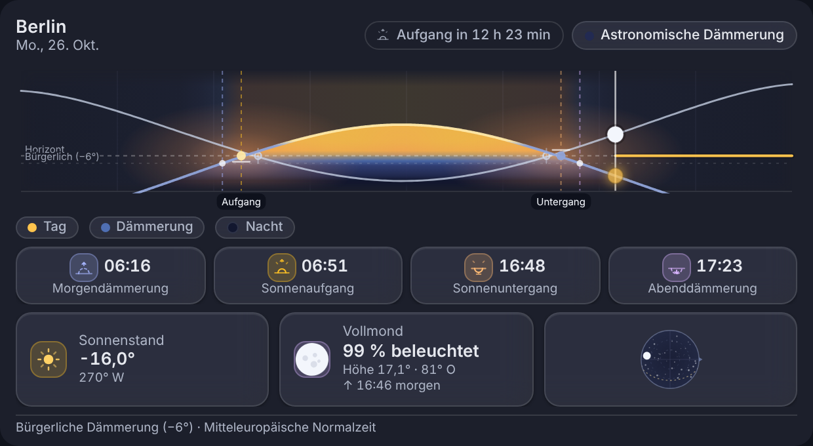

# Sun & Moon Card for Home Assistant

[](https://github.com/cercytrone/ha-sun-moon-card/actions/workflows/ci.yml)
[](LICENSE)
[](https://hacs.xyz)

A standalone Lovelace card (`custom:sun-moon-card`) for Home Assistant: it draws the **sun’s path
for the day** as a curve with sunrise and sunset, the **current sun position**, the **twilight
phases** (civil, nautical, astronomical) and a **sky view** with moon phase, illumination, moon
position and moonrise/moonset.

Everything is computed **locally in the browser** – no external service, no network requests, no
images, and no additional Home Assistant integration is required.



*More views: [light](docs/screenshot-default-light.png) · [card heights](docs/screenshot-heights.png) ·
[narrow cards](docs/screenshot-narrow.png) · [variants](docs/screenshot-variants.png) ·
[astronomical details](docs/screenshot-details.png) · [polar day](docs/screenshot-polar-day.png) ·
[polar night](docs/screenshot-polar-night.png) · [minimal variant](docs/screenshot-minimal.png) ·
[minimal variant, horizon style](docs/screenshot-minimal-horizon.png) ·
[English / 12-hour format](docs/screenshot-english.png) ·
[golden hour with countdown tile](docs/screenshot-golden-hour.png)*

> **Deutsche Fassung:** [README.md](README.md) – the German README is the full documentation
> (installation, every YAML option, accuracy, edge cases, development).

---

## Features

- **Day curve (centrepiece):** SVG chart of the sun’s altitude across the local day (00:00–24:00)
  with civil dawn/dusk, sunrise, sunset, optional nautical (−12°) and astronomical (−18°) twilight,
  coloured phase bands, the current sun position on the curve, a “now” line and local-time labels.
  The phase bands fade into each other instead of forming hard stripes, daylight turns warmer
  towards the horizon, and the area above the curve is tinted by time of day – night at the edges,
  warm light at sunrise and sunset, with a soft glow on the horizon line. The plot is slightly
  rounded and all fills fade out at the edges instead of ending on a hard line; curve, markers and
  labels stay crisp. A **second curve plots the moon’s course** over the same day: because the moon
  rises about every 24 h 50 min, its arc sits differently each day – sometimes opposite the sun,
  sometimes nearly parallel. The elevation axis takes the moon in, so both arcs stay fully visible;
  that flattens the sun curve on days when the moon reaches much higher or lower. Moonrise and
  moonset are marked on the moon curve with the time in their tooltip. A **“now” line carries two
  markers**: a golden dot for the sun’s current
  elevation and a moon disc in its current phase for the moon’s. They step aside when they would
  overlap, and a marker whose body sits outside the plotted elevation range is dimmed at the edge
  with the exact value in its tooltip. `card_style: flat` renders all gradients thinner, and
  **`card_style: horizon` fills only the space between curve and horizon** – day as a hill above
  the axis, night as a valley below, with the sky gradient off and glow and moon curve stepped back.
- **Minimal variant (`minimal_mode: true`):** the card shows the timeline only – the curve with
  sunrise and sunset, the current sun position and the “now” line. Header, times row, details,
  footer and legend are dropped; the design of the timeline is kept, merely stripped down (no grid,
  no labels, no moon course, and of the altitude lines only the horizon remains). Card heights down
  to **24 px** are possible, so the card also works as a narrow strip below 100 px and still shows
  where the sun stands in the day. A click (or `Enter` / `Space`) opens the full card with the same
  configuration in an overlay (720 × 460 px, adjustable with `popup_width` and `popup_height`);
  `Escape`, a click outside or the close button dismisses it.
- **Times above the minimal strip:** a twelve-pixel row names the **sunrise time on the left**,
  the **zenith (culmination) time in the middle** and the **sunset time on the right** – in the
  configured time format, with the full wording in their tooltips. Sunrise/sunset and the zenith
  time can be **switched off separately** (`minimal_show_times`, `minimal_show_zenith`); if an
  event does not exist (polar day, polar night) its entry is dropped rather than replaced by a
  placeholder. The row needs 36 px of card height and is omitted below that.
- **Tap actions on the minimal strip:** tap, hold and double tap can be bound with `tap_action`,
  `hold_action` and `double_tap_action` – Home Assistant’s standard actions (`more-info`,
  `navigate`, `url`, `call-service`, `toggle`, `fire-dom-event`, `none`) plus `open-popup` for the
  overlay. Without any configuration a tap still opens the overlay.
- **One sun size for every view:** the sun marker follows the same rule in the minimal, compact
  and full view: its radius grows with the plot height up to `sun_marker_size` (**default 6 px**,
  adjustable **2–12 px**) and never drops below 2.8 px on very flat strips. The position in the day
  therefore reads equally well everywhere – including where a 3.5 px dot used to sit.
- **Sky view:** fisheye projection with cardinal directions, horizon and zenith; sun and moon are
  drawn **along their computed diurnal path** (altitude/azimuth), together with the moon disc
  showing the correct terminator for the current phase.
- **Current position of sun and moon:** elevation above (or below) the horizon plus compass
  direction – in the detail tiles and as a readout beneath the sky view (“Sun: 42.1° · 180° S”).
  Below the horizon the card names the depth and, where space allows, keeps the direction.
- **Time until the next rise or set:** a chip in the header counts down to **sunrise or
  sunset** (“Sunset in 1 h 48 min”; on narrow cards just “1 h 48 min”, and the chip wins over the sky-phase chip); an earlier moonrise/moonset or twilight limit does not displace it.
  Without a sun event (polar day/night, `show_sun: false`) it falls back to the next twilight or
  moon event; `remaining_time_focus: next` always shows the soonest event. An **icon shows which body is
  meant**, because “rise” alone would leave sun and moon open; screen readers get the full name
  instead (“Moonrise in 1 h 21 min”). The tooltip names the event and its clock time and adds
  “(tomorrow)” when it falls on the following day. Beneath the sky view
  the pending countdowns are spelled out (“Sunset in 2 h 15 min”), as many as the space allows –
  the sky dome never shrinks below 72 px. On the minimal strip the countdown appears in the
  tooltip and in the screen-reader text. It is computed from the card’s own altitude curve, not
  from the `sun` entity attributes: when no event occurs within 48 hours (polar day, polar night)
  the countdown is omitted rather than invented. Switch it off with `show_remaining_time: false`;
  in the chart a **track on the horizon** marks the time from now to the event; without a header
  (low cards, compact mode) a small label next to the now line shows the countdown (“↓ 1 h 48 min”).
  On narrow cards the footer drops the method first, then the time zone (the tooltip keeps the full
  text), and narrow charts label events with clock times; sunrise/sunset labels take priority and
  labels that do not fit are dropped instead of overlapping. Durations carry units (“1 h 48 min”,
  day length “9 h 57 min −4 min”); in the final minute it reads “Sunset now”. The **next full
  moon** is listed last below the sky view (“Full moon in 3 d 4 h”) and never becomes the main
  countdown. With `twilight_level: all` the twilight countdown uses **civil** twilight (−6°).
- **Next event highlighted:** the next upcoming time of the day is outlined in its accent colour.
- **Golden and blue hour** (optional, `show_golden_hour: true`, toggle in the editor): golden hour
  (sun between −4° and +6°) and blue hour (−6° to −4°) are shaded in the day chart, with their times
  in the tooltip; a countdown to the next golden hour (or to its end) is added, and
  `remaining_time_focus: golden_hour` puts it in the header chip.
- **Countdown tile** (optional, `show_countdown_tile: true`, toggle in the editor): a large tile at
  the start of the times row shows the main countdown – “1 h 48 min · Daylight left” by day,
  “9 h 53 min · until Sunrise” at night. When space is tight, twilight tiles give way first.
- **Times and details:** row with dawn, sunrise, sunset, dusk; optionally culmination with maximum
  altitude, day length with change vs. yesterday, azimuth on a 16-point compass (“Sun: 250° WSW”),
  azimuth at rise/set, “sun X° below the horizon”, moon age, moon distance with perigee/apogee,
  moonrise and moonset, and the **next full moon** with date, time and days to go. A footer names
  the time zone, the twilight limit and the calculation method. Times follow the Home Assistant
  language and 12/24-hour setting.
- **Robust:** free card height (120–800 px or `auto`, 24–800 px in the minimal variant), every
  section can be switched off, compact mode, minimal variant, theme mode, three card styles
  (`glass`, `flat`, `horizon`), animations, visual editor **and** YAML,
  `setConfig()` / `getCardSize()` / `getGridOptions()` / `getConfigElement()`. Missing entities,
  missing attributes or a missing location never break the card – it shows a hint instead.
- **Accessible:** colours follow the Home Assistant theme variables; measured WCAG contrast of the
  weakest label is **6.46:1** (light theme) and **6.77:1** (dark theme), i.e. above the 4.5:1
  threshold for normal text. The check does not calculate but measures: it photographs the card in
  real Chromium and takes the colour **behind every label** from the rendered pixels – including
  labels that sit on the chart gradients. Symbols are `aria-hidden`, values exist as text, the card
  is keyboard-focusable.

## Installation

**HACS (custom repository).** HACS → Frontend → ⋮ → Custom repositories → add
`https://github.com/cercytrone/ha-sun-moon-card` with category **Lovelace** → download
*Sun-Moon Card* → reload the browser.

**Manual.** Copy `dist/sun-moon-card.js` from the
[latest release](https://github.com/cercytrone/ha-sun-moon-card/releases) to
`config/www/sun-moon-card.js`, then add it under *Settings → Dashboards → ⋮ → Resources*:

| Field | Value |
|-------|-------|
| URL | `/local/sun-moon-card.js` |
| Type | JavaScript module |

## Quick start

```yaml
type: custom:sun-moon-card
```

That is enough: location, time zone, language, time format and theme are taken from Home Assistant.

## Examples

```yaml
# Compact card for a narrow column
type: custom:sun-moon-card
card_height: 160
compact_mode: true
show_twilight: false
```

```yaml
# Everything on
type: custom:sun-moon-card
card_height: 380
twilight_level: all          # civil | nautical | astronomical | all
show_astronomical_details: true
location_name: Garden house
```

```yaml
# Minimal variant: the timeline as a narrow strip
type: custom:sun-moon-card
minimal_mode: true
card_height: 48           # allowed from 24 px; a click opens the full card
minimal_show_times: true  # sunrise on the left, sunset on the right
minimal_show_zenith: true # culmination in the middle
sun_marker_size: 6        # sun radius, 2–12 px, also applies to the full view
popup_width: 720          # overlay width, 320–1200 px
popup_height: 460         # overlay height, 260–800 px
```

```yaml
# Tap actions on the minimal strip
type: custom:sun-moon-card
minimal_mode: true
card_height: 48
tap_action:
  action: more-info        # default: open-popup (open the overlay)
  entity: weather.home     # defaults to sun.sun
hold_action:
  action: navigate
  navigation_path: /lovelace/weather
double_tap_action:
  action: call-service
  perform_action: light.turn_on
  target:
    entity_id: light.hallway
```

Supported actions are `none`, `more-info`, `navigate`, `url`, `call-service` (alias
`perform-action`), `toggle`, `fire-dom-event` and the card’s own `open-popup`. They follow the
Home Assistant standard so they can be copied from other cards; they act on the minimal strip and
are configured in YAML only. An unknown action is dropped and reported on the card.

```yaml
# Own coordinates, English, 12-hour clock
type: custom:sun-moon-card
latitude: 78.2232
longitude: 15.6469
language: en
time_format: 12
card_height: 320
```

## Configuration options

| Option | Values | Default | Meaning |
|--------|--------|---------|---------|
| `entity` | entity id | `sun.sun` | Sun entity of the HA sun integration |
| `moon_entity` | entity id | `sensor.moon` | Optional moon entity (phase name is taken from it) |
| `card_height` | px (120–800, 24–800 in the minimal variant) or `auto` | `340` | Card height; `auto` → 320 px narrow, 360 px wide. The visual editor keeps the height editable while no `card_height` is set; only `auto` locks slider and number field |
| `show_sun` | boolean | `true` | Show sun (chart, detail row) |
| `show_moon` | boolean | `true` | Show moon |
| `show_twilight` | boolean | `true` | Show twilight phases |
| `show_astronomical_details` | boolean | `false` | Culmination and maximum altitude, day length with change vs. yesterday, azimuth, azimuth at rise/set, “sun X° below the horizon”, extra twilight layers, moon age, moon distance with perigee/apogee, next full moon |
| `compact_mode` | boolean | `false` | Compact layout (no header, sky view or detail row) |
| `minimal_mode` | boolean | `false` | Minimal variant: the timeline only, without header, times row, details, footer and legend. Allows card heights from 24 px; a click opens the full card in an overlay |
| `minimal_show_times` | boolean | `true` | Minimal variant: name the sunrise (left) and sunset (right) time above the timeline. Needs 36 px of card height |
| `minimal_show_zenith` | boolean | `true` | Minimal variant: name the culmination time in the middle above the timeline. Needs 36 px of card height |
| `sun_marker_size` | px (2–12) | `6` | Radius of the sun marker on the timeline. The marker grows with the plot height up to this value and stays at least 2.8 px on flat strips. Applies to the minimal, compact and full view alike |
| `popup_width` | px (320–1200) | `720` | Width of the minimal variant’s overlay (capped at 92 % of the window width) |
| `popup_height` | px (260–800) | `460` | Height of the minimal variant’s overlay – independent of `card_height` |
| `tap_action` | action | opens the overlay | Action when the minimal strip is tapped |
| `hold_action` | action | – | Action when the strip is held (from 400 ms) |
| `double_tap_action` | action | – | Action on a double tap (within 250 ms). When set, a single tap waits for that window |
| `card_style` | `glass` \| `flat` \| `horizon` | `glass` | `glass` draws translucent blurred tiles, `flat` uses solid surfaces without filters (better on weak devices), `horizon` fills only the space between curve and horizon line |
| `show_footer` | boolean | `true` | Footer with time zone, twilight limit and calculation method |
| `theme_mode` | `auto` \| `light` \| `dark` | `auto` | `auto` follows the Home Assistant theme |
| `animations` | boolean | `true` | Animations (pulsing “now” marker, transitions) |
| `time_format` | `auto` \| `12` \| `24` | `auto` | `auto` follows Home Assistant |
| `language` | `auto` \| `de` \| `en` | `auto` | `auto` follows Home Assistant |
| `show_header` | boolean | `true` | Header with location, date and sky phase |
| `show_day_chart` | boolean | `true` | Day curve |
| `show_sky_view` | boolean | `true` | Sky view |
| `show_events` | boolean | `true` | Times row |
| `show_moon_times` | boolean | `true` | Moonrise / moonset |
| `show_remaining_time` | boolean | `true` | Time until the next rise/set of sun, twilight and moon |
| `remaining_time_focus` | `sun` / `next` / `golden_hour` | `sun` | Which countdown takes precedence: `sun` always shows sunrise/sunset in the header chip and minimal strip (and lists it first below the sky view); `next` shows the soonest event of sun, twilight or moon; `golden_hour` the next golden hour (requires `show_golden_hour`, otherwise like `sun`) |
| `show_golden_hour` | boolean | `false` | Golden and blue hour shaded in the day chart, plus a countdown to the next golden hour |
| `show_countdown_tile` | boolean | `false` | Large countdown tile at the start of the times row |
| `twilight_level` | `civil` \| `nautical` \| `astronomical` \| `all` | `civil` | Which twilight limits are drawn (−6°, −12°, −18°); with `all` the twilight countdown uses civil twilight |
| `location_name` | text | – | Display name, replaces the Home Assistant location name |
| `latitude` / `longitude` | number | from HA | Override the Home Assistant coordinates |

Invalid values do not break the card: numbers are clamped (with a console warning) and unknown
choices fall back to the default. Only a completely unusable `card_height` is rejected – the
visual editor then shows the reason.

## Entities and data sources

Location, time zone, language and time format come from `hass.config` / `hass.locale`; the theme
from `hass.themes` / `hass.selectedTheme`. Sun and twilight times are read from `sun.sun`
(`next_rising`, `next_setting`, `next_dawn`, `next_dusk`) **only** if they belong to the current
day and differ from the local calculation by at most 20 minutes – otherwise the computed value is
used. The moon phase name is read from `sensor.moon` when it exists. Nothing is written back to
Home Assistant and no data leaves the browser.

## Astronomy accuracy

The astronomy is fully contained in `src/astronomy.ts` and validated against **astral** (the
library used by Home Assistant’s `sun` integration) and **PyEphem** (ELP2000-82). Measured maximum
deviations over the reference fixture set (20 sun cases, 36 moon cases):

| Quantity | Maximum deviation |
|----------|-------------------|
| Sunrise/sunset, twilight times | **≤ 32 s** (vs. PyEphem), **≤ 37 s** (vs. astral) |
| Solar altitude | **≤ 0.02°** (measured 0.011°) |
| Solar azimuth | **≤ 0.03°** (measured 0.021°) |
| Lunar altitude (apparent) | **≤ 0.05°** (measured 0.019°) |
| Lunar azimuth | **≤ 0.1°** (measured 0.021°) |
| Moon illumination | **≤ 0.01 pp** (measured 0.003) |
| Moon distance | **≤ 150 km** (measured 81 km) |
| Bright limb position angle | **≤ 2°** (measured 0.25°) |
| Moonrise / moonset | **≤ 60 s** (measured 7.2 s) |

**Next full moon:** the moment when the Sun–Moon phase angle reaches 180° (maximum illuminated
fraction). Deviation vs. PyEphem over the reference set: **≤ 2.6 min**. “Blue Moon” appears only
when that full moon really is the second one in its calendar month – the previous full moon is
compared within the same month, no month names are involved.

**Month names are folklore, not astronomy.** The card can show the traditional name of the full
moon (October: “Hunter's Moon”). These names come from the Anglo-American almanac tradition, vary
by region and carry no astronomical meaning, so the card always labels them as a **folk name**.

**No VSOP87:** the methods are the ones described above (NOAA/Meeus for the Sun, a truncated
ELP2000/Meeus series for the Moon). No full VSOP87 or ELP2000-82B ephemeris is computed; accuracy
follows the table above, not an observatory almanac.

Time zones, DST rules and 23/25-hour days are handled through the browser’s `Intl` API (IANA data).

## Edge cases

| Case | Behaviour |
|------|-----------|
| Polar day (no sunset) | The tile reads “no sunset”; no invented time, the header notes the polar day |
| Polar night (no sunrise) | “No sunrise”; the curve stays below the horizon, day length is omitted |
| No civil twilight (high latitudes in summer) | Twilight times are omitted (“—”) with an explanatory hint |
| Daylight saving change | The chart covers the real 23/25-hour day, all labels stay in local time |
| Missing location | The card shows a hint and **no** times instead of computing for 0/0 |
| Missing `sun.sun` or attributes | Everything is computed locally; implausible HA values are discarded |
| Traditional full-moon names | Shown as a **folk name**; regional tradition, not an astronomical quantity |
| Next full moon | Accurate to about ±5 min (measured ≤ 2.6 min vs. PyEphem); month names and “Blue Moon” refer to the calendar month of the configured time zone |

## Development

Requirements: **Node.js 22.19 or newer** (the test stack uses jsdom/undici, which requires it;
Node 20 left LTS support in April 2026). The card bundle itself runs in any modern browser – the
Node version only matters for building and testing.

```bash
npm ci
npm run dev          # demo page with many card variants, http://localhost:5173
npm run typecheck
npm run lint
npm test             # 290 Vitest checks (152 against astral/PyEphem reference values)
npm run build        # -> dist/sun-moon-card.js
npm run verify       # typecheck + lint + tests
```

Screenshots are generated in real Chromium (`npm run dev` must be running, then
`npm run screenshots`); the layout QA run (`npm run verify:layout`) checks 34 cases: heights
120–800 px, widths from 320 px, seven locations, polar day/night, missing data, the time-axis
scaling of the chart, WCAG contrast and console errors; CI runs it as a separate job against the
dev server. `puppeteer-core` is a dev dependency; the browser comes from `CHROME_PATH` (or, as a
fallback, `npm install --no-save @sparticuz/chromium`).

## License

[GPL-3.0](LICENSE).
