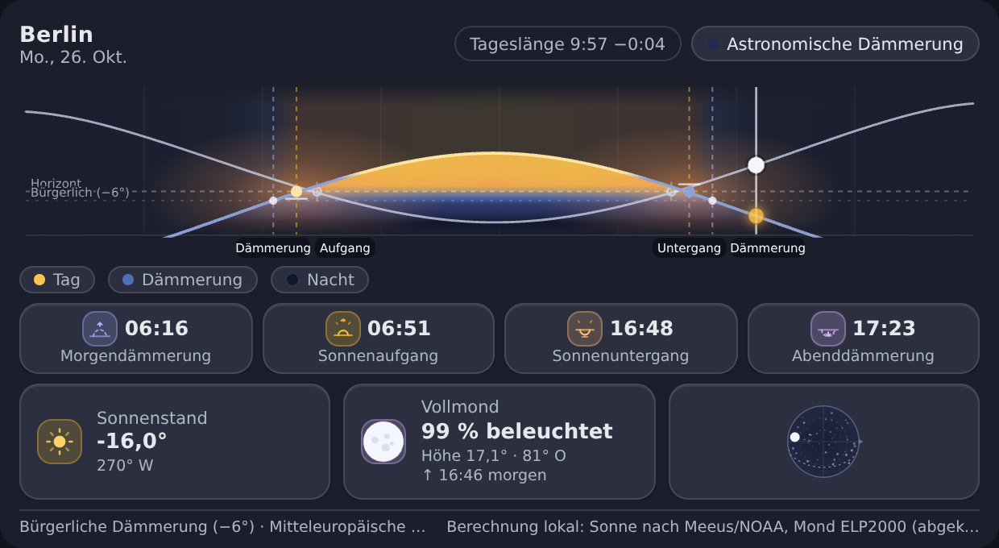

# Sonne & Mond – Karte für Home Assistant

[](https://github.com/cercytrone/ha-sun-moon-card/actions/workflows/ci.yml)
[](LICENSE)
[](https://hacs.xyz)

Eine eigenständige Lovelace-Karte (`custom:sun-moon-card`) für Home Assistant: Sie zeigt den
**Sonnenverlauf des Tages** als Kurve mit Sonnenauf- und -untergang, den aktuellen Sonnenstand,
die **Dämmerungsphasen** (bürgerlich, nautisch, astronomisch) sowie eine **Himmelsansicht** mit
Mondphase, Beleuchtungsgrad, Mondstand und Mondauf-/untergang.

Alle Berechnungen laufen **lokal im Browser** – es werden keine externen Dienste abgefragt, keine
Bilder nachgeladen und keine zusätzlichen Home-Assistant-Integrationen benötigt.



*Weitere Ansichten: [Hell](docs/screenshot-default-light.png) ·
[Kartenhöhen](docs/screenshot-heights.png) · [Schmale Karten](docs/screenshot-narrow.png) ·
[Varianten](docs/screenshot-variants.png) · [Astronomische Details](docs/screenshot-details.png) ·
[Polartag](docs/screenshot-polar-day.png) · [Polarnacht](docs/screenshot-polar-night.png) ·
[Minimalvariante](docs/screenshot-minimal.png) ·
[Minimalvariante im Horizontstil](docs/screenshot-minimal-horizon.png) ·
[Englisch / 12-Stunden-Format](docs/screenshot-english.png)*

> **English version:** [README.en.md](README.en.md)

---

## Inhalt

1. [Funktionen](#funktionen)
2. [Installation](#installation)
3. [Schnellstart](#schnellstart)
4. [Beispielkonfigurationen](#beispielkonfigurationen)
5. [Alle Konfigurationsoptionen](#alle-konfigurationsoptionen)
6. [Visueller Editor](#visueller-editor)
7. [Verwendete Entitäten und Datenquellen](#verwendete-entitäten-und-datenquellen)
8. [Astronomie: Genauigkeit und Grenzen](#astronomie-genauigkeit-und-grenzen)
9. [Sonderfälle: Polartag, Polarnacht, fehlende Daten](#sonderfälle-polartag-polarnacht-fehlende-daten)
10. [Layout und Kartenhöhe](#layout-und-kartenhöhe)
11. [Barrierefreiheit, Performance, Datenschutz](#barrierefreiheit-performance-datenschutz)
12. [Aktualisieren und Deinstallieren](#aktualisieren-und-deinstallieren)
13. [Entwicklung](#entwicklung)
14. [Bekannte Einschränkungen](#bekannte-einschränkungen)
15. [Lizenz](#lizenz)

---

## Funktionen

**Tagesverlauf (Kernstück)**

- SVG-Kurve des Sonnenstands über den gesamten lokalen Tag, von 00:00 bis 24:00 Uhr
- Markierte Übergänge: bürgerliche Morgen-/Abenddämmerung, Sonnenaufgang, Sonnenuntergang
- optionale nautische (−12°) und astronomische (−18°) Dämmerungslinien und -flächen
- Farbige Phasenbereiche für Nacht, Dämmerung und Tag (eigene Palette für helles und dunkles Theme)
- **Zweite Kurve für den Mond**: derselbe Verlauf, für den Mond gerechnet. Weil der Mond im Mittel
  alle 24 h 50 min aufgeht, liegt sein Bogen an jedem Tag anders – mal gegenläufig zur Sonne, mal
  fast parallel. Die Höhenachse nimmt ihn mit auf, beide Bögen bleiben also vollständig sichtbar;
  dadurch wird die Sonnenkurve flacher, wenn der Mond an diesem Tag viel höher oder tiefer steht
- Mondauf- und -untergang als Marken auf der Mondkurve, mit Uhrzeit im Tooltip
- Aktuelle Sonnenposition als Marker auf der Kurve und Fläche darunter
- „Jetzt“-Linie mit Uhrzeitbeschriftung, Achsenbeschriftungen in lokaler Zeit
- Weicher Horizontbogen; die Kurve ist auch unterhalb des Horizonts (Nachtverlauf) korrekt
  skaliert und wird nicht abgeschnitten
- Höhenlinien mit Beschriftung (Horizont, −6°/… je nach Dämmerungsgrenze), Zenit-Chip mit
  Kulminationszeit und maximaler Höhe, farbig gestrichelte Führungslinien zu den Ereignissen
- **„Jetzt"-Linie mit Sonnen- und Mondmarker**: der goldene Punkt zeigt die aktuelle Sonnenhöhe,
  die Mondscheibe in ihrer aktuellen Phase die des Mondes. Liegen beide dicht beieinander, weicht
  der Mond seitlich aus; liegt ein Körper außerhalb des dargestellten Höhenbereichs, steht sein
  Marker gedämpft am Rand – der Tooltip nennt dann den genauen Wert
- Legende der Phasenflächen unter dem Verlauf
- **Farbverläufe statt harter Streifen:** die Phasenbereiche gehen weich ineinander über, das
  Tageslicht wird zum Horizont hin wärmer
- **Himmelsfläche über der Kurve:** gefärbt nach Tageszeit – Nacht an den Rändern, warmes Licht an
  Auf- und Untergang –, dazu ein weiches Horizontglühen auf der Horizontlinie
- Der Plot ist leicht abgerundet und die Flächen laufen an allen Rändern weich aus, damit der
  Verlauf nicht an einer Kante abbricht. Kurve, Marken und Beschriftungen bleiben davon
  unberührt – sie tragen die Information und bleiben scharf
- `card_style: flat` trägt alle Verläufe dünner auf, `glass` zeigt sie in voller Stärke
- **`card_style: horizon`** füllt nur den Raum **zwischen Kurve und Horizont**: Der Tag steht als
  Berg über der Achse, die Nacht als Tal darunter. Der Himmelsverlauf über der Kurve entfällt,
  Horizontglühen und Mondkurve treten zurück – die Fläche trägt die Aussage
- **`minimal_mode: true` – die Minimalvariante:** Die Karte zeigt ausschließlich den Zeitstrahl,
  also die Kurve mit Auf- und Untergang, dem Sonnenstand und der „Jetzt“-Linie. Kopfzeile,
  Zeitenleiste, Details, Fußzeile und Legende entfallen, das Design des Zeitstrahls bleibt
  erhalten und wird nur abgespeckt (kein Raster, keine Beschriftungen, kein Mondgang, von den
  Höhenlinien bleibt der Horizont). Die Kartenhöhe darf damit **bis auf 24 px** sinken – auch
  unter 100 px bleibt ablesbar, wo die Sonne im Tag steht. Ein Klick (oder die Taste
  `Eingabe`/`Leertaste`) öffnet die vollständige Karte mit derselben Konfiguration in einem
  Overlay; `Escape`, ein Klick daneben oder der Schließen-Knopf beenden es

**Zweite Ansicht: aktueller Himmel**

- Fischaugen-Projektion des Himmels mit Himmelsrichtungen (N/O/S/W), Horizontlinie und Zenit
- Höhenringe bei 30° und 60° mit Beschriftung, feiner Sternenhintergrund bei Nacht
  (datumsabhängig, aber fest – keine Zufallswerte pro Aktualisierung)
- Sonne und Mond auf ihrer **Tagesbahn** (aus Höhe und Azimut des Tagesverlaufs berechnet),
  nicht als frei erfundene Himmelsposition
- Mond als **beleuchtete/unbeleuchtete Scheibe**: Phasenfigur mit korrekt gedrehter
  Beleuchtungsgrenze (Positionswinkel der hellen Seite), Beleuchtungsgrad in Prozent
- Sonnen- und Mondbahn über den Tag, Mond auf-/untergehend je nach Stand

**Zeiten und Details**

- Zeitenleiste mit Morgendämmerung, Sonnenaufgang, Sonnenuntergang, Abenddämmerung – ergänzt um
  nautische/astronomische Dämmerung, wenn konfiguriert
- **Aktuelle Stellung von Sonne und Mond**: Höhe über (bzw. unter) dem Horizont und
  Himmelsrichtung, in den Detailkacheln und als Ablesung unter der Himmelsansicht
  („Sonne: 42,1° · 180° S“). Unter dem Horizont nennt die Karte die Tiefe und, wenn Platz
  ist, weiter die Richtung
- Optional: Kulmination (Sonnenhöchststand), Tageslänge **mit Änderung zum Vortag**, Azimut von
  Sonne und Mond in der 16-teiligen Windrose („Sonne: 250° WSW“), Azimut bei Auf- und Untergang,
  „Sonne X° unter dem Horizont“, Mondalter, Mondentfernung mit Erdferne/Erdnähe, Mondauf-/
  untergang mit Azimut und Tagesversatz, **nächster Vollmond** mit Datum, Uhrzeit und
  Tagesabstand
- Fußzeile mit Zeitzone (ausgeschrieben), eingestellter Dämmerungsgrenze und Berechnungsverfahren
- Zeiten im 12- oder 24-Stunden-Format, standardmäßig wie in Home Assistant eingestellt

**Konfiguration und Robustheit**

- Frei wählbare Kartenhöhe in Pixeln (oder `auto`), geprüft von 120 bis 800 px – in der
  Minimalvariante von 24 bis 800 px
- Alle Bereiche einzeln abschaltbar (`show_*`), Kompaktmodus, Minimalvariante, Theme-Modus,
  Animationen
- Drei Kartenstile: `card_style: glass` (halbtransparente Kacheln, Standard), `flat`
  (deckende Flächen ohne Weichzeichner – für schwache Geräte) und `horizon`
  (Fläche nur zwischen Kurve und Horizont)
- Visual Editor **und** YAML; `setConfig()`, `getCardSize()`, `getGridOptions()`,
  `getConfigElement()`, `getStubConfig()`
- Keine Abstürze bei fehlender Entität, fehlenden Attributen oder fehlendem Standort – stattdessen
  ein Hinweis in der Karte
- Keinerlei Netzwerkzugriffe zur Laufzeit, keine externen Schriften oder Bilder

---

## Installation

### Variante A: HACS (empfohlen)

1. In Home Assistant **HACS → Frontend → ⋮ → Benutzerdefinierte Repositories** öffnen.
2. Repository `https://github.com/cercytrone/ha-sun-moon-card` mit Kategorie **Lovelace**
   (Dashboard) hinzufügen.
3. **Sun-Moon Card** in HACS suchen, herunterladen und anschließend
   **Einstellungen → Oberflächen** neu laden (bzw. den Browser-Cache leeren).
4. Die Karte steht danach im Dashboard-Editor unter „Benutzerdefiniert“ zur Verfügung.

> Da es sich um ein benutzerdefiniertes Repository handelt, erscheint die Karte nicht im
> HACS-Standardkatalog. Das ist bei eigenen Karten normal.

### Variante B: Manuell

1. `dist/sun-moon-card.js` aus dem [letzten Release](https://github.com/cercytrone/ha-sun-moon-card/releases)
   herunterladen (die `.js.map`-Datei ist optional und hilft nur beim Debuggen).
2. In das Verzeichnis `config/www/` von Home Assistant kopieren, z. B. als
   `config/www/sun-moon-card.js`.
3. Unter **Einstellungen → Dashboards → ⋮ → Ressourcen** eine neue Ressource anlegen:

   | Feld | Wert |
   |------|------|
   | URL | `/local/sun-moon-card.js` |
   | Typ | JavaScript-Modul |

4. Dashboard neu laden. Danach kann die Karte per YAML eingebunden werden; der Visual Editor
   steht ebenfalls zur Verfügung (die Erkennung benutzerdefinierter Karten kann einen weiteren
   Reload benötigen).

---

## Schnellstart

```yaml
type: custom:sun-moon-card
```

Das genügt: Die Karte übernimmt Standort, Zeitzone, Sprache, Zeitformat und Theme aus Home
Assistant und zeigt Tagesverlauf, Himmelsansicht und die wichtigsten Zeiten.

---

## Beispielkonfigurationen

**Kompakt für schmale Spalten**

```yaml
type: custom:sun-moon-card
card_height: 160
compact_mode: true
show_twilight: false
```

**Ausführlich mit allen Dämmerungsgrenzen**

```yaml
type: custom:sun-moon-card
card_height: 380
twilight_level: all
show_astronomical_details: true
location_name: Gartenhaus
```

**Nur der Tagesverlauf (ohne Mond und Himmelsansicht)**

```yaml
type: custom:sun-moon-card
card_height: 200
show_moon: false
show_sky_view: false
show_header: false
```

**Minimalvariante: Zeitstrahl als schmaler Streifen**

```yaml
type: custom:sun-moon-card
minimal_mode: true
card_height: 48   # möglich ab 24 px; ein Klick öffnet die vollständige Karte
```

**Feste Sprache und Zeitformat, helles Theme**

```yaml
type: custom:sun-moon-card
language: de
time_format: 24
theme_mode: light
animations: false
```

**Astronomie ohne Home-Assistant-Standort (z. B. Ferienhaus)**

```yaml
type: custom:sun-moon-card
location_name: Longyearbyen
latitude: 78.2232
longitude: 15.6469
card_height: 320
```

**Mehrere Karten in einem Dashboard**

```yaml
type: vertical-stack
cards:
  - type: custom:sun-moon-card
    card_height: 140
    compact_mode: true
    show_header: false
  - type: custom:sun-moon-card
    card_height: 360
    show_astronomical_details: true
    twilight_level: nautical
```

---

## Alle Konfigurationsoptionen

| Option | Typ / Werte | Standard | Bedeutung |
|--------|-------------|----------|-----------|
| `type` | `custom:sun-moon-card` | – | Kartentyp (von Home Assistant gesetzt) |
| `entity` | Entitäts-ID | `sun.sun` | Sonnen-Entität der HA-Sun-Integration |
| `moon_entity` | Entitäts-ID | `sensor.moon` | Optionale Mond-Entität (Phasenname wird übernommen, wenn vorhanden) |
| `card_height` | Zahl in px oder `auto` | `340` | Höhe der Karte; Bereich **120–800** (empfohlen 180–420), in der Minimalvariante **24–800**, `auto` wählt 320 px auf schmalen und 360 px auf breiten Karten |
| `show_sun` | `true` / `false` | `true` | Sonne (Chart, Detailzeile) anzeigen |
| `show_moon` | `true` / `false` | `true` | Mond anzeigen |
| `show_twilight` | `true` / `false` | `true` | Dämmerungsphasen anzeigen |
| `show_astronomical_details` | `true` / `false` | `false` | Zusätzliche Details: Kulmination mit maximaler Höhe, Tageslänge mit Änderung zum Vortag, Azimut, Azimut bei Auf-/Untergang, „Sonne X° unter dem Horizont“, nautische/astronomische Dämmerung, Mondalter, Mondentfernung mit Erdferne/-nähe, nächster Vollmond |
| `compact_mode` | `true` / `false` | `false` | Kompakte Darstellung ohne Kopfzeile, Himmelsansicht und Detailzeile |
| `minimal_mode` | `true` / `false` | `false` | Minimalvariante: nur der Zeitstrahl, ohne Kopfzeile, Zeitenleiste, Details, Fußzeile und Legende. Erlaubt Kartenhöhen ab 24 px; ein Klick öffnet die vollständige Karte in einem Overlay |
| `card_style` | `glass` \| `flat` \| `horizon` | `glass` | `glass` zeichnet halbtransparente Kacheln mit Weichzeichnung, `flat` deckende Flächen ohne Filter (besser für schwache Geräte), `horizon` füllt im Chart nur den Raum zwischen Kurve und Horizontlinie |
| `show_footer` | `true` / `false` | `true` | Fußzeile mit Zeitzone, Dämmerungsgrenze und Berechnungsverfahren |
| `theme_mode` | `auto` \| `light` \| `dark` | `auto` | `auto` folgt dem Home-Assistant-Theme |
| `animations` | `true` / `false` | `true` | Animationen (pulsierender „Jetzt“-Marker, Übergänge) |
| `time_format` | `auto` \| `12` \| `24` | `auto` | `auto` übernimmt die Einstellung aus Home Assistant |
| `language` | `auto` \| `de` \| `en` | `auto` | `auto` folgt der Sprache aus Home Assistant |
| `show_header` | `true` / `false` | `true` | Kopfzeile mit Ort, Datum und Himmelsphase |
| `show_day_chart` | `true` / `false` | `true` | Tagesverlaufs-Chart |
| `show_sky_view` | `true` / `false` | `true` | Himmelsansicht |
| `show_events` | `true` / `false` | `true` | Zeitenleiste |
| `show_moon_times` | `true` / `false` | `true` | Mondauf-/untergang |
| `twilight_level` | `civil` \| `nautical` \| `astronomical` \| `all` | `civil` | Welche Dämmerungsgrenzen dargestellt werden (−6°, −12°, −18°, alle) |
| `location_name` | Text | leer | Anzeigename; ersetzt den Standortnamen aus Home Assistant |
| `latitude` | Zahl −90…90 | aus HA | Überschreibt den Breitengrad aus Home Assistant |
| `longitude` | Zahl −180…180 | aus HA | Überschreibt den Längengrad aus Home Assistant |

Ungültige Werte führen nicht zu einem Fehlerbild: Unbrauchbare Zahlen werden korrigiert und als
Warnung in die Browserkonsole geschrieben, Auswahlwerte fallen auf den Standard zurück. Nur wenn
`card_height` überhaupt nicht als Zahl erkennbar ist, weist die Karte die Konfiguration ab – der
Visual Editor zeigt den Grund dann an.

---

## Visueller Editor

Beim Hinzufügen der Karte öffnet sich der Editor mit vier Gruppen:

- **Darstellung** – Kartenhöhe (Schieberegler und Zahlenfeld), automatische Höhe, Farbschema,
  Zeitformat, Sprache, Animationen, Kompaktmodus, Minimalvariante, Dämmerungsgrenze
- **Bereiche** – Schalter für Sonne, Mond, Dämmerung, astronomische Details, Kopfzeile,
  Tagesverlauf, Himmelsansicht, Zeitenleiste, Mondauf-/untergang
- **Verhalten** – Sonnen- und Mond-Entität
- **Standort** – Anzeigename, Breiten- und Längengrad, Schalter „Standort aus Home Assistant
  übernehmen“, Zurücksetzen

Die Kartenhöhe bleibt bedienbar, solange in der YAML kein `card_height` steht: Der Editor zeigt
dann die gültige Standardhöhe (340 px) an. Erst die Option „Automatische Höhe“ – also
`card_height: auto` – sperrt Schieberegler und Zahlenfeld, weil die Höhe dann von der Kartenbreite
abhängt.

Standardwerte werden nicht in die Konfiguration geschrieben – die YAML bleibt dadurch kurz und
lesbar. Der Editor ist lokalisiert (Deutsch/Englisch) und ohne zusätzliche
Home-Assistant-UI-Komponenten gebaut, funktioniert also auch in älteren Oberflächen.

---

## Verwendete Entitäten und Datenquellen

| Quelle | Verwendung |
|--------|------------|
| `hass.config.latitude` / `longitude` | Standort (wenn nicht per Konfiguration überschrieben) |
| `hass.config.time_zone` | Zeitzone für alle Zeitangaben |
| `hass.config.location_name` | Anzeigename des Standorts |
| `hass.locale.language` / `hass.language` | Sprache (bei `language: auto`) |
| `hass.locale.time_format` | 12-/24-Stunden-Format (bei `time_format: auto`) |
| `hass.themes.darkMode` / `hass.selectedTheme` | helles/dunkles Theme (bei `theme_mode: auto`) |
| `sun.sun` (`next_rising`, `next_setting`, `next_dawn`, `next_dusk`) | Sonnen- und Dämmerungszeiten, sofern sie zum aktuellen Tag passen und höchstens **20 Minuten** von der eigenen Berechnung abweichen |
| `sun.sun` (`elevation`, `azimuth`) | werden in der Detailzeile angezeigt, wenn vorhanden |
| `sensor.moon` (Zustand) | Phasenname der Moon-Integration (8 Phasen), rein optional |

**Fehlt etwas, bricht nichts ab:** Ohne `sun.sun`, ohne Attribute oder ohne Standort berechnet die
Karte selbst (sofern ein Standort bekannt ist) oder zeigt einen Hinweis. Abweichende oder
veraltete Werte aus Home Assistant werden verworfen, nicht ungeprüft übernommen.

Es werden **keine** Zustände geschrieben, **keine** Dienste aufgerufen und **keine** externen
Daten geladen.

---

## Astronomie: Genauigkeit und Grenzen

Die Astronomie steckt vollständig in `src/astronomy.ts` (Sonnenstand nach NOAA/Meeus,
Refraktion und Sonnenradius wie in der Home-Assistant-Sun-Integration, Mond nach einer
angefassten ELP2000/Meeus-Reihe). Validiert wird gegen zwei unabhängige Referenzen:

- **astral** – die Bibliothek, die Home Assistants `sun`-Integration verwendet
- **PyEphem** (ELP2000-82) – hochgenaue Standardreihen

Referenzdatensatz: 20 Standort-/Datumsfälle für die Sonne (Berlin, New York, Sydney, Quito,
Longyearbyen, Tromsø, Kapstadt; Winter, Sommer, Tagundnachtgleiche, Zeitumstellung) und 36 Fälle
für den Mond. Gemessene maximale Abweichungen:

| Größe | Maximale Abweichung |
|-------|---------------------|
| Sonnenauf-/untergang, Dämmerungszeiten | **≤ 32 s** (vs. PyEphem), **≤ 37 s** (vs. astral) |
| Sonnenhöhe | **≤ 0,02°** (gemessen 0,011°) |
| Sonnenazimut | **≤ 0,03°** (gemessen 0,021°) |
| Mondhöhe (scheinbar, mit Parallaxe) | **≤ 0,05°** (gemessen 0,019°) |
| Mondazimut | **≤ 0,1°** (gemessen 0,021°) |
| Beleuchtungsgrad des Mondes | **≤ 0,01 Prozentpunkte** (gemessen 0,003) |
| Mondentfernung | **≤ 150 km** (gemessen 81 km) |
| Positionswinkel der hellen Mondseite | **≤ 2°** (gemessen 0,25°) |
| Mondauf-/Monduntergang | **≤ 60 s** (gemessen 7,2 s) |

**Nächster Vollmond:** Der Zeitpunkt wird gesucht, an dem der Phasenwinkel zwischen Sonne und
Mond 180° erreicht (Maximum des Beleuchtungsgrades). Abweichung zu PyEphem im Referenzdatensatz:
**≤ 2,6 min**. „Blue Moon“ erscheint nur, wenn dieser Vollmond tatsächlich der zweite Vollmond
seines Kalendermonats ist – die Prüfung vergleicht den vorherigen Vollmond im selben Monat, sie
nutzt keine Monatsnamen.

**Monatsnamen sind Volksgut, keine Astronomie.** Die Karte kann den überlieferten Namen des
Vollmonds anzeigen (Oktober: „Jägermond“, englisch „Hunter's Moon“). Diese Namen stammen aus der
angloamerikanischen Almanach-Tradition, sind regional unterschiedlich und astronomisch
bedeutungslos. Sie werden deshalb in der Anzeige ausdrücklich als **Volksname** gekennzeichnet.

**Kein VSOP87:** Die genannten Verfahren sind die oben beschriebenen Reihen (NOAA/Meeus für die
Sonne, gekürzte ELP2000/Meeus-Reihe für den Mond). Es wird keine volle VSOP87- oder
ELP2000-82B-Ephemeride gerechnet; die Genauigkeit entspricht den Werten in der Tabelle, nicht der
einer Sternwarte.

Zeitzonen, Sommer-/Winterzeit und historische Regeln kommen aus der `Intl`-API des Browsers
(`IANA`-Datenbank), nicht aus einer eigenen Tabelle. Tage mit Zeitumstellung sind 23 oder 25
Stunden lang – die Zeitachse und alle Zeitangaben berücksichtigen das; lokale Tage werden über
`Intl` berechnet, nicht durch Addition von 24 Stunden.

Die Werte werden **nicht** aus externen Quellen ergänzt: Alles entsteht zur Laufzeit aus
Standort, Datum und Uhrzeit.

---

## Sonderfälle: Polartag, Polarnacht, fehlende Daten

| Fall | Verhalten der Karte |
|------|---------------------|
| **Polartag** (Sonne geht nicht unter, z. B. Longyearbyen im Juni) | Kein Sonnenuntergang/keine Abenddämmerung: die Kachel zeigt „kein Untergang“ statt einer erfundenen Uhrzeit. Der Verlauf bleibt ganztägig über dem Horizont, die Kopfzeile weist auf den Polartag hin. |
| **Polarnacht** (Sonne geht nicht auf) | Entsprechend „kein Aufgang“; die Kurve bleibt unter dem Horizont, Tageslänge entfällt. |
| **Keine bürgerliche Dämmerung** (hohe Breiten um die Sommersonnenwende: Sonne bleibt über −6°) | Die Dämmerungszeiten entfallen („—“), ein Hinweis erklärt den Grund. |
| **Zeitumstellung** | Die Zeitachse des Charts umfasst den tatsächlich 23 bzw. 25 Stunden langen Tag; die Zeiten sind durchgehend in Ortszeit angegeben. |
| **Standort fehlt** (`hass.config` ohne Koordinaten und keine `latitude`/`longitude` konfiguriert) | Die Karte zeigt einen Hinweis und **keine** Zeiten, statt mit 0/0 zu rechnen. |
| **`sun.sun` fehlt** | Die Karte berechnet alles selbst; in der Detailzeile entfallen die HA-Werte. |
| **Attribute fehlen** (`next_rising` usw. leer) | Eigene Berechnung wird verwendet; unplausible HA-Werte (Abweichung > 20 min) werden verworfen. |
| **Äquator / Südhalbkugel** | Ganzjährig korrekte Auf-/Untergänge; die Himmelsansicht spiegelt die südliche Bahn korrekt. |

Es werden bewusst **keine** Ersatzzeiten erfunden: Wo ein Ereignis astronomisch nicht existiert,
bleibt das Feld leer und wird als solches beschriftet.

---

## Layout und Kartenhöhe

Die Kartenhöhe ist frei einstellbar (120–800 px, `auto` möglich). Die Karte entscheidet in
festen Schwellen, welche Bereiche Platz haben – ein einmal sichtbarer Bereich verschwindet beim
Vergrößern nicht wieder, und der Tagesverlauf wächst monoton mit:

| Kartenhöhe | Inhalt |
|------------|--------|
| ab 120 px | nur der Tagesverlauf |
| ab 180 px | + Zeitenleiste (Dämmerung, Auf-/Untergang) und Fußzeile |
| ab 192 px | + Legende der Phasenflächen |
| ab 226 px | + Kopfzeile mit Ort, Datum und Himmelsphase |
| ab 302 px | + Detailzeile mit Sonnenstand und Monddaten |
| ab 326 px | + Detailzeile mit den astronomischen Zusatzwerten |

Die Himmelsansicht erscheint ab **700 px Kartenbreite** als eigene Spalte neben dem Verlauf,
darunter als kleines Element in der Detailzeile; unter 430 px Breite entfällt sie dort zugunsten
der Texte. Alle Beschriftungen werden an die verfügbare Breite angepasst (kurze Formen wie
„Aufgang“ statt „Sonnenaufgang“) – abgeschnittene Texte werden durch automatisierte
Layoutprüfungen ausgeschlossen.

Jeder Bereich erhält seine Höhe aus dieser Rechnung, der Verlauf nimmt den Rest. Damit ist die
Karte in sich exakt so hoch wie eingestellt: `2 × Innenabstand + Bereiche + Abstände +
Verlaufshöhe = Kartenhöhe`.

Es gibt keine versteckte Mindesthöhe: auch bei 120 px wird nichts abgeschnitten, und bei 800 px
entsteht keine ungenutzte Fläche, weil der Tagesverlauf den verbleibenden Platz einnimmt.

**Minimalvariante.** Mit `minimal_mode: true` entfällt diese Rechnung: Der Zeitstrahl ist die
ganze Karte, die Höhe gehört allein ihm (`2 × 4 px Rand + Verlauf = Kartenhöhe`). Der
Schwellenwert von 120 px gilt dann nicht – geprüft sind Höhen von 24 px bis 800 px. Der
Höhenbereich des Verlaufs richtet sich in der Minimalvariante nach der Sonne allein, damit die
Kurve die wenigen Pixel voll ausnutzt. Der Streifen ist eine Schaltfläche: Er ist per Tastatur
erreichbar, im Screenreader als Karte mit Auf- und Untergangszeit beschrieben und öffnet die
vollständige Variante.

---

## Barrierefreiheit, Performance, Datenschutz

- **Kontrast:** eigene Farbpaletten für helle und dunkle Themes; Textfarben folgen den
  Home-Assistant-Theme-Variablen, damit die Karte in jedem Theme lesbar bleibt. Gemessen wird
  nicht gerechnet: die Prüfung fotografiert die Karte in echtem Chromium und bestimmt die Farbe
  **hinter jeder Beschriftung** aus den Bildpunkten – auch dort, wo der Farbverlauf des Charts
  unter dem Text liegt. Die schwächste Beschriftung erreicht **6,46:1** im hellen und **6,77:1**
  im dunklen Theme, also deutlich mehr als die Schwelle für normale Schrift (4,5:1).
  Beschriftungen im Chart erhalten dafür einen Rand in Kartenhintergrundsfarbe bzw. ein
  deckkräftiges Kärtchen.
- **Tastatur/Assistenz:** die Karte ist per Tastatur erreichbar (Fokusrahmen), Symbole sind als
  `aria-hidden` markiert, Zahlenwerte sind als Text vorhanden; die Zeitenkacheln tragen einen
  `title` mit vollständiger Bezeichnung. Der Minimalstreifen ist eine Schaltfläche: `Eingabe`
  oder `Leertaste` öffnen das Overlay, `Escape` schließt es und gibt den Fokus an die Karte
  zurück. Das Overlay ist als `role="dialog"` mit `aria-modal` gekennzeichnet und trägt einen
  beschrifteten Schließen-Knopf.
- **Performance:** astronomische Berechnungen werden nur einmal pro Minute (bzw. bei relevanten
  Änderungen) ausgeführt und zwischengespeichert. Ein `ResizeObserver` aktualisiert die Breite,
  die Uhr tickt minutengenau zum Zeitpunkt des Minutenwechsels; ohne Änderung erfolgen keine
  DOM-Aktualisierungen.
- **Datenschutz:** keine Netzwerkzugriffe, kein Telemetrie, keine externen Schriften oder Bilder.
  Alle Grafiken sind SVG, alle Berechnungen lokal.
- **Größe:** das Bundle (`dist/sun-moon-card.js`) enthält Lit und wiegt rund 95 kB
  (unkomprimiert) – keine weiteren Laufzeitabhängigkeiten.

---

## Aktualisieren und Deinstallieren

**Aktualisieren (HACS):** HACS → Frontend → **Sun-Moon Card** → Aktualisieren; anschließend das
Dashboard neu laden (Browser-Cache leeren, falls die alte Version weiterhin erscheint).

**Aktualisieren (manuell):** neue `sun-moon-card.js` nach `config/www/` kopieren und das
Dashboard neu laden. Wenn sich die Ressourcen-URL nicht geändert hat, genügt ein Reload.

**Deinstallieren:**

1. Karte aus allen Dashboards entfernen.
2. HACS: unter Frontend → Sun-Moon Card → Entfernen; manuell: Ressource unter
   *Einstellungen → Dashboards → Ressourcen* löschen und `config/www/sun-moon-card.js`
   entfernen.
3. Dashboard neu laden. Es bleiben keine Daten zurück – die Karte speichert nichts außerhalb der
   Dashboard-Konfiguration.

---

## Entwicklung

Voraussetzung: **Node.js 22.19 oder neuer** (die Testumgebung nutzt jsdom/undici, das diese
Version verlangt; Node 20 ist seit April 2026 nicht mehr im LTS-Support). Das Karten-Bundle
selbst läuft in jedem aktuellen Browser – die Node-Version betrifft nur Bau und Tests.

```bash
git clone https://github.com/cercytrone/ha-sun-moon-card.git
cd ha-sun-moon-card
npm ci
```

| Befehl | Zweck |
|--------|-------|
| `npm run dev` | Entwicklungsumgebung mit mehreren Karten, Standort-/Themen-/Zeitvorgaben und Fehlerfällen (`http://localhost:5173`) |
| `npm run typecheck` | TypeScript-Prüfung ohne Ausgabe |
| `npm run lint` | ESLint über Quellen, Entwicklungsumgebung, Tests und Werkzeuge |
| `npm test` | Alle Unit- und Komponententests (Vitest, 324 Prüfungen) |
| `npm run build` | Bundle nach `dist/sun-moon-card.js` (esbuild, minifiziert, mit Lit) |
| `npm run verify` | Typen + Lint + Tests in einem Durchlauf |
| `npm run screenshots` | Screenshots nach `docs/` (siehe unten) |
| `npm run verify:layout` | Layoutprüfung in echtem Chromium: Höhen 120–800 px, Breiten ab 320 px, sieben Standorte, Polartag/Polarnacht, fehlende Daten, Zeitleisten-Skalierung, WCAG-Kontrast (gemessen am Bildpunkt) und Konsolenfehler (58 Prüfungen) |

**Aufbau**

```
src/
  sun-moon-card.ts        Karte (Lit-Element, setConfig/getCardSize/getGridOptions)
  sun-moon-card-editor.ts Visual Editor (eigene Bedienelemente, keine HA-UI-Bausteine)
  astronomy.ts            Sonnenstand, Sonnenereignisse, Mond, Dämmerung, Himmelsphasen
  lunar-series.ts         Generierte Mondreihen (nicht von Hand bearbeiten)
  timezone.ts             Ortszeit, Sommerzeit, Tagesgrenzen (Intl)
  model.ts                Konfigurationsvalidierung und Anzeigemodell
  const.ts                Standardwerte, Farbpaletten, Layout
  format.ts, localize.ts  Zeit-/Zahlenformatierung, Deutsch und Englisch
  utils.ts, icons.ts      Geometrie/SVG, Symbole
  components/             day-chart, sky-view, moon-disc
tests/                    Vitest: Astronomie-Referenzwerte, Konfiguration, Modell,
                          Layout, Formatierung, Komponententests (jsdom)
dev/                      Entwicklungsumgebung und Screenshot-Vorlage
tools/                    Screenshots, Layoutprüfung, Erzeugung der Mondreihen/Referenzwerte
```

**Tests:** 324 Prüfungen, davon 166 gegen Referenzwerte aus astral und PyEphem. Die Messwerte in
`tests/fixtures/reference.json` wurden mit `tools/reference-values.py` erzeugt (Python mit
`astral`, `ephem`, `numpy`); die Mondreihen in `src/lunar-series.ts` mit
`tools/fit-lunar-series.py --emit-ts`.

**Screenshots:** Screenshots entstehen automatisiert in echtem Chromium:

```bash
npm run dev                       # in einem zweiten Terminal
npm run screenshots               # schreibt die PNGs nach docs/
```

Benötigt werden `puppeteer-core` und `@sparticuz/chromium` (nur für dieses Werkzeug, nicht in den
Projektabhängigkeiten):

```bash
npm install --no-save puppeteer-core @sparticuz/chromium
# oder einen eigenen Browser nutzen:
CHROME_PATH=/usr/bin/chromium npm run screenshots
```

**Release:** `.github/workflows/release.yml` – per `workflow_dispatch` mit Versionsnummer wird
die Version erhöht, gebaut, getaggt und anschließend ein GitHub-Release mit
`dist/sun-moon-card.js` erzeugt (die Quelle für HACS). `.github/workflows/ci.yml` prüft bei
Push und Pull Request Typen, Lint, Tests, Build und ob das eingecheckte Bundle aktuell ist.

---

## Bekannte Einschränkungen

- Die **Himmelsansicht** zeigt Sonne und Mond auf ihrer Tagesbahn (Höhe/Azimut des
  Tagesverlaufs). Das ist keine exakte 2D-Himmelsposition aus einem Sternkatalog, sondern eine
  projektive Darstellung der berechneten Bahn – ausdrücklich als Näherung gekennzeichnet.
- Mondposition, -entfernung und Beleuchtung stützen sich auf eine **gekürzte Mondreihe**
  (Genauigkeit siehe Tabelle oben, typisch deutlich besser als die Grenzwerte). Für
  wissenschaftliche Anwendungen ist sie nicht gedacht.
- Mondauf- und -untergang werden mit der Standardhöhe nach Meeus bestimmt; in extremen
  Polarlagen kann an einzelnen Tagen kein Ereignis existieren – dann bleibt das Feld leer.
- Die Karte folgt dem Theme, aber nicht jeder benutzerdefinierten Theme-Variable: Es werden die
  Standard-Variablen von Home Assistant (`--primary-color`, `--card-background-color`,
  `--primary-text-color` usw.) verwendet.
- Sehr alte Browser ohne Web Components, `ResizeObserver` oder vollständige `Intl`-Zeitzonendaten
  werden nicht unterstützt (aktuelle Chrome, Firefox, Safari und Edge funktionieren).
- Ohne konfigurierten Standort und ohne Koordinaten in Home Assistant zeigt die Karte einen
  Hinweis, aber keine Zeiten – das ist beabsichtigt (keine erfundenen Werte).
- Die überlieferten **Vollmondnamen** („Jägermond“) sind Volkstradition und regional
  unterschiedlich; sie werden als solche gekennzeichnet und sind keine astronomische Größe.
- Der nächste Vollmond wird auf **±5 Minuten** genau bestimmt (gemessen ≤ 2,6 min zu PyEphem).
  Monatsnamen und „Blue Moon“ beziehen sich auf den Kalendermonat der eingestellten Zeitzone.
- Das Overlay der Minimalvariante wird an `document.body` gehängt und legt sich über das ganze
  Fenster. Es verwendet keine Home-Assistant-Dialogkomponente, damit es in allen Oberflächen
  funktioniert; seine Gestalt folgt deshalb den Theme-Variablen, nicht jeder benutzerdefinierten
  Karte.

---

## Lizenz

[GPL-3.0](LICENSE) – wie das mitgelieferte `LICENSE` des Repositories.
